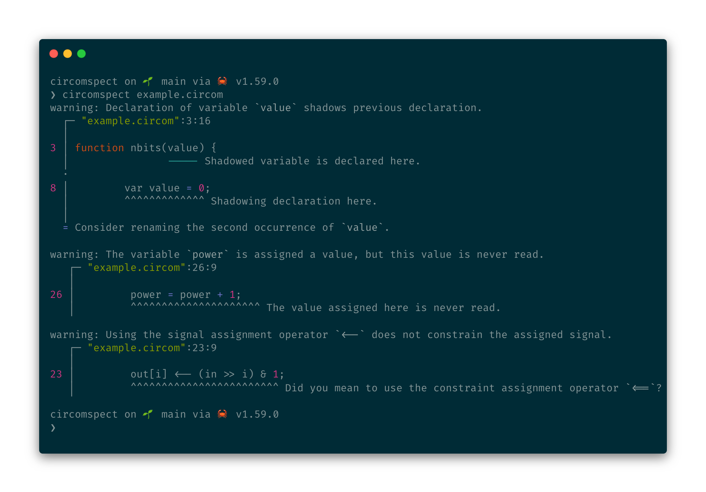
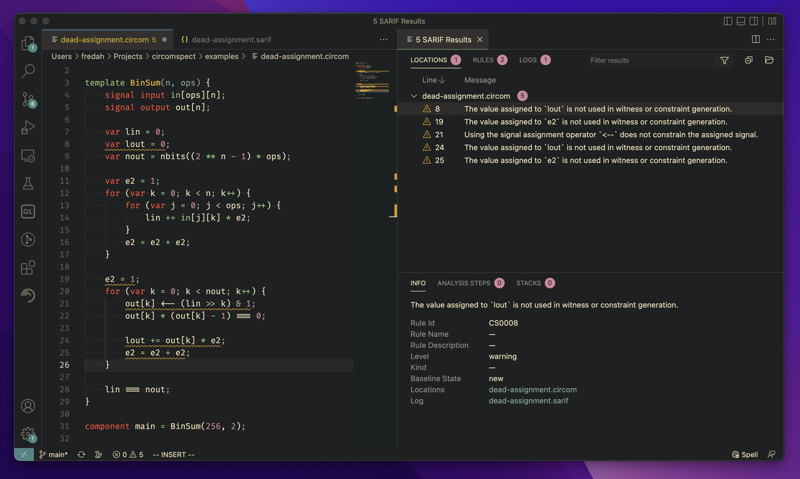

# Circomspect 🔎

 

Circomspect is a static analyzer and linter for the [Circom](https://iden3.io/circom)
programming language. It has its own recovering parser and typed semantic representation
for Circom 2.2.3. The Circom compiler is used as a development test oracle, not a runtime
dependency.

Circomspect analyzes functions, templates, and their call contexts using a shared abstract
interpretation engine. It reports properties supported by certified facts and identifies
incomplete analysis separately.



## Installing Circomspect

Circomspect is available on [crates.io](https://crates.io/crates/circomspect) and can be installed by invoking

```sh
  cargo install circomspect
```

To build Circomspect from source, simply clone the repository and build the
project by running `cargo build` in the project root. To install from source, use

```sh
  cargo install --path cli
```

## Running Circomspect

To run Circomspect on a file or directory, simply run

```sh
  circomspect path/to/circuit
```

By default, Circomspect outputs warnings and errors to stdout. To see informational results as well you can set the output level using the `--level` option. To ignore certain types of results, you can use the `--allow` option together with the corresponding result ID. (The result ID can be obtained by passing the `--verbose` flag to Circomspect.)

To output the results to a Sarif file (which can be read by the [VSCode Sarif Viewer](https://marketplace.visualstudio.com/items?itemName=MS-SarifVSCode.sarif-viewer)), use the option `--sarif-file`.



Circomspect supports the same curves that Circom does: BN254, BLS12-381, and Goldilocks. If you are using a different curve than the default (BN254) you can set the curve using the command line option `--curve`.

Libraries do not need a `main` component. Input directories are searched
recursively for `.circom` files. Use `-L path/to/library` to resolve includes;
the path may name a directory or an individual library file. Results from
included files are hidden unless the file is also an input; errors remain
visible.

The analyzer recovers from source errors where possible and continues through
independent definitions. Actionable `CS0020` notices name the affected checks,
explain the limitation, and suggest a next step. Missing-context notices are
informational (`-l INFO`) and hidden by default; nonactionable notices are omitted.
Repeated findings at the same source location are grouped while retaining their
affected call paths. No visible reports means exit status 0; any
visible warning, informational result, or error means exit status 1.

Source errors and findings appear as analysis progresses. Each finding is printed
once; any call paths discovered later appear in an additional note. Coverage
notices wait until their affected checks have been collected. The final summary
and SARIF file contain the complete grouped results.

Bus declarations are parsed and resolved, but their analysis contexts remain
unsupported and produce `CS0020`. Custom templates and other unsupported
dependencies also retain scoped incomplete-analysis diagnostics.

Development uses Rust 1.99.0; the tested minimum supported Rust version is 1.74.
Run `cargo test --workspace --locked`, `cargo clippy --all-targets --all-features -- -D warnings`,
and `cargo fmt --all -- --check` from the project root. Dependency checks use
`cargo deny --workspace --all-features --locked check --deny warnings`.
Compiler comparison tests require the pinned compiler described in `tests/conformance`.

## Analysis Passes

Circomspect implements analysis passes for a number of different types of issues. A complete list, together with a high-level description of each issue, can be found [here](https://github.com/trailofbits/circomspect/blob/main/doc/analysis_passes.md).
